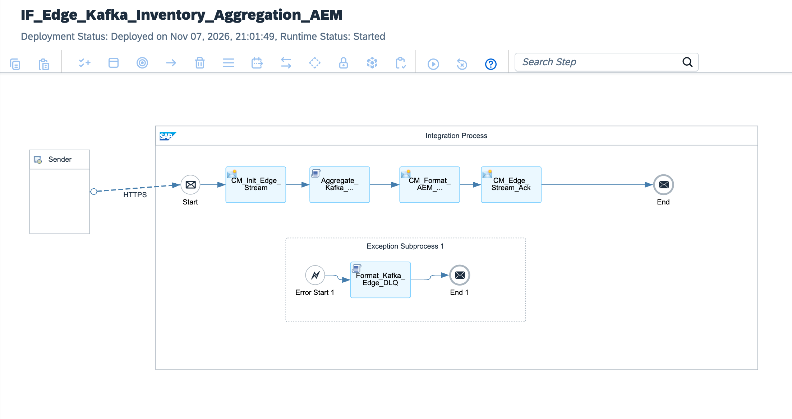

# Hybrid Edge Computing: Edge Integration Cell (EIC), Apache Kafka & SAP Advanced Event Mesh

[](https://www.sap.com)
[](https://kafka.apache.org)
[](https://www.sap.com)
[](https://cloudevents.io)
[](https://www.sap.com)

---

## Executive Summary

High-throughput industrial IoT, shopfloor manufacturing executions, and automated warehouse robotics generate telemetry at velocities exceeding 10,000 events/second. Transmitting unaggregated raw streams over corporate WAN directly into central ERP systems triggers severe network backpressure, high egress costs, and JVM thread exhaustion.

This architecture deploys **SAP Edge Integration Cell (EIC)** in a hybrid topology:
1. **Local Edge Ingestion:** Operates on-premises within a Kubernetes runtime directly adjacent to local Apache Kafka clusters, guaranteeing sub-millisecond ingestion latency without internet reliance.
2. **In-Flight Micro-Batch Aggregation:** Compresses high-frequency inventory movements and sensor telemetry into micro-batches in memory using custom Groovy streaming aggregators, reducing WAN transactions by over 95%.
3. **CloudEvents 1.0 Canonicalization:** Transforms vendor-specific Kafka records into standardized **CloudEvents 1.0 AMQP envelopes** enriched with enterprise correlation headers (`specversion`, `type`, `source`, `subject`).
4. **Reliable Upstream Streaming:** Forwards aggregated events to **SAP Advanced Event Mesh (AEM)** for enterprise-wide pub/sub distribution and S/4HANA stock updates, equipped with an automated on-premise Dead-Letter Queue (DLQ) fallback.

---

## Architecture Overview



### High-Level Topology

```text
[Shopfloor Edge Kafka Cluster (Topic: plant-inventory-stream-v1)]
          │
          │ High-Volume Streaming (>10,000 msg/s)
          ▼
[SAP Edge Integration Cell (EIC Runtime - On-Premises K8s)]
  ├── 1. Streaming Webhook Ingestion (/edge/kafka/inventory/stream):
  │    └─ Captures high-velocity payloads without WAN transit
  │
  ├── 2. Micro-Batch Aggregator (Aggregate_Kafka_Inventory_Stream.groovy):
  │    ├─ In-memory thread-safe tumbling window accumulator
  │    ├─ Consolidates redundant material movements by Plant / Storage Location
  │    └─ Injects CloudEvents 1.0 specification metadata
  │
  ├── 3. Edge Security Context (CM_Edge_Security_Context):
  │    └─ Injects mutual TLS provenance headers and EIC pod instance IDs
  │
  ├── 4. Outbound AMQP / HTTPS Forwarder:
  │    └─ Dispatches compressed CloudEvents micro-batch to SAP Advanced Event Mesh (AEM)
  │
  └── 5. Exception Subprocess (Format_Kafka_Edge_DLQ.groovy):
       └─ Quarantines corrupted event frames to local Edge DLQ without blocking stream
```

---

## Technical Specifications

| Architectural Dimension | Monolithic Cloud Ingestion | Hybrid Edge Integration Cell (EIC + Kafka) |
| :--- | :--- | :--- |
| **Runtime Location** | Multi-tenant Cloud Foundry (BTP) | On-Premises Kubernetes Cluster (Local Edge Node) |
| **Ingestion Latency** | 150ms – 400ms (WAN Dependent) | < 5ms (Local LAN / Subnet Ingestion) |
| **Network Resilience** | WAN drops halt shopfloor operations | Local Kafka buffering guarantees offline continuity |
| **Payload Optimization** | 10,000 individual ERP API calls/sec | 95% reduction via in-flight micro-batch aggregation |
| **Event Standard** | Proprietary JSON / XML schema | Strict CNCF CloudEvents 1.0 AMQP/JSON standard |
| **Failover Strategy** | Cloud Dead-Letter Queue | Local edge-resident dead-letter storage for replay |

---

## CloudEvents 1.0 Aggregated Batch Structure

```json
{
  "specversion": "1.0",
  "id": "CE-EIC-9910-20261107-0042",
  "source": "/edge/plant/1010/line/04/kafka",
  "type": "com.sap.inventory.movement.aggregated.v1",
  "subject": "MATERIAL_STOCK_RECONCILIATION",
  "time": "2026-11-07T21:15:00Z",
  "datacontenttype": "application/json",
  "data": {
    "batchContext": {
      "edgeNodeId": "k8s-eic-node-eu-west-01",
      "aggregatedRecordsCount": 450,
      "aggregationWindowSec": 5
    },
    "aggregatedMovements": [
      {
        "materialId": "MAT-RAW-STEEL-44",
        "plant": "1010",
        "storageLocation": "RM01",
        "totalNetDelta": 1250.0,
        "uom": "KG",
        "movementType": "101"
      }
    ]
  }
}
```

---

## Repository Structure

```text
├── README.md                                             # Enterprise architecture & operations runbook
├── sap-cpi-edge-kafka-runtime-architecture.png           # Integration flow runtime topology diagram
├── ADR-001-Edge-Integration-Cell-Kafka-Streaming.md     # Architecture Decision Record
├── IF_Edge_Kafka_Inventory_Aggregation_AEM.zip           # Production iFlow bundle export
├── cpi/
│   └── scripts/
│       ├── Aggregate_Kafka_Inventory_Stream.groovy       # In-flight stream aggregator & CloudEvents builder
│       └── Format_Kafka_Edge_DLQ.groovy                  # Edge incident & dead-letter queue formatter
├── tests/
│   └── sample_kafka_inventory_stream.json                # Sample raw Kafka stream test payload
└── .gitignore                                            # Git exclusion rules
```

---

## Verification & Deployment Runbook

### 1. Edge Integration Cell Verification
Confirm the EIC runtime node status via SAP Integration Suite Monitor:
```text
Runtime Environment: Edge Integration Cell (Kubernetes)
State: Active / Started
```

### 2. Dispatched cURL Test (Simulated Kafka EIC Ingestion)
Execute a high-frequency micro-batch payload to the local EIC endpoint:

```bash
curl -X POST \
  'https://<eic-edge-runtime-domain>/http/edge/kafka/inventory/stream' \
  -H 'Content-Type: application/json' \
  -H 'Authorization: Bearer <EIC_LOCAL_TOKEN>' \
  --data-binary '@tests/sample_kafka_inventory_stream.json'
```

### 3. Monitoring Trace
* Verify processing under **Monitor Message Processing** filtering by `Edge Integration Cell`.
* Validate that properties `Aggregated_Items_Count` and `CloudEvents_Message_ID` are recorded.
* Confirm successful delivery to SAP Advanced Event Mesh topic `sap/edge/inventory/aggregated/v1`.

---

## Author

**Željko Popov**  
*Integration Architect | SAP Integration Suite & Clean Core Specialist*  
[GitHub Repositories](https://github.com/neurozeljko)
